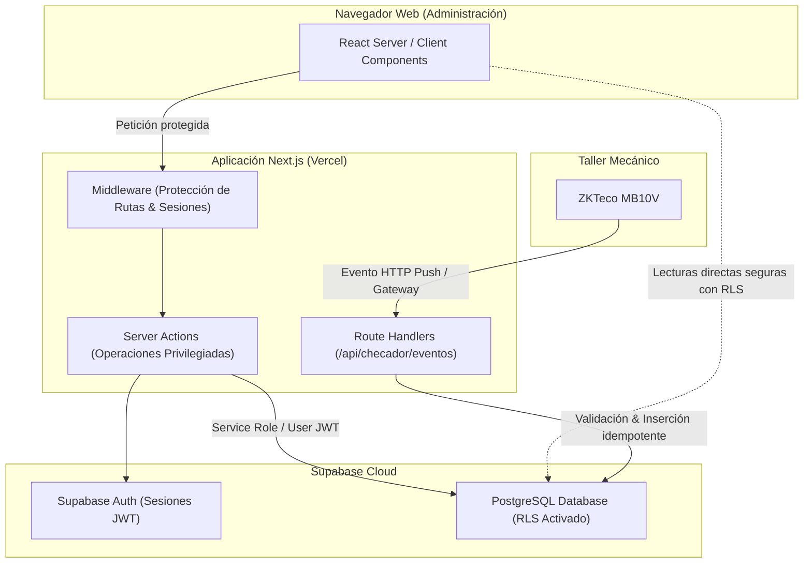
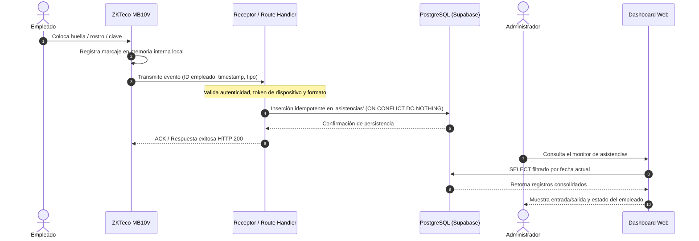
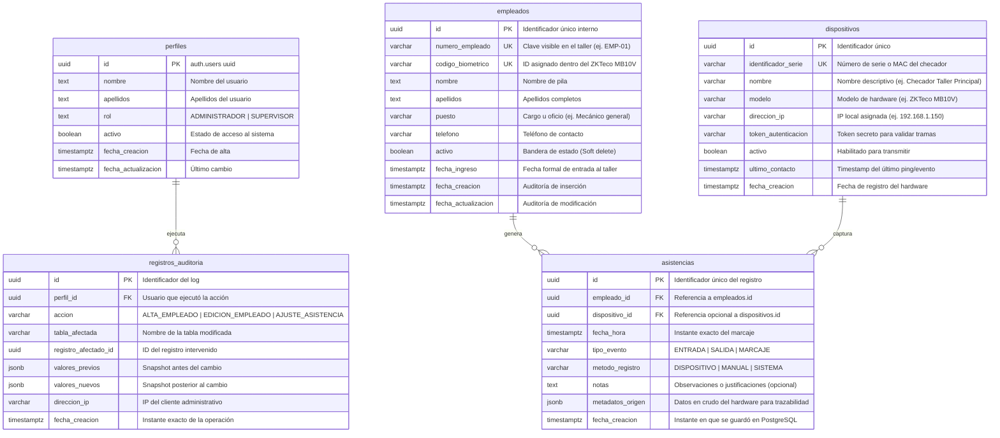
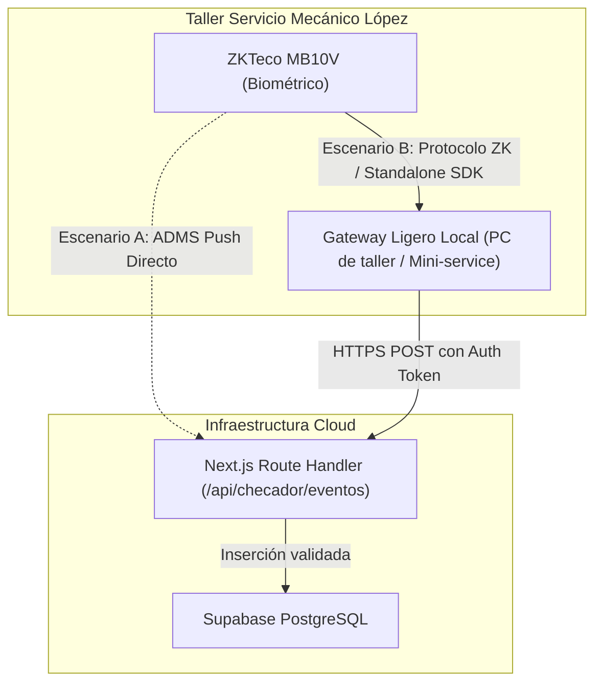

# PROJECT ARCHITECTURE | NOLAN by WYLEN
## Sistema de Control de Asistencia — Servicio Mecánico López

> **Documento de Referencia Técnica y Arquitectónica**  
> **Versión:** 1.0.0  
> **Fecha:** Noviembre 2026  
> **Autor:** Software Architect Senior — WYLEN  
> **Estado:** Documento Maestro Activo  

---

## 1. DESCRIPCIÓN EJECUTIVA

**NOLAN by WYLEN** es una plataforma web administrativa diseñada a la medida para centralizar, automatizar y auditar el control de asistencia de los empleados de **Servicio Mecánico López**.

El propósito fundamental de NOLAN es sustituir el registro manual en papel o planillas informales por un sistema seguro, confiable y económico de operar. La solución combina una interfaz administrativa moderna en la nube con la recepción y procesamiento de marcajes provenientes de un dispositivo biométrico físico (ZKTeco MB10V), asegurando la integridad, inmutabilidad y trazabilidad de cada registro de asistencia.

### Principio Rector del Proyecto
> *"Construir una solución administrativa sencilla, segura, eficiente y profesional. Evitar complejidad e infraestructura innecesaria, sin sacrificar la protección de datos, la confiabilidad de los registros ni la calidad del software. Simplicidad en el diseño, rigor en la seguridad y claridad en la implementación."*

---

## 2. CONTEXTO GENERAL Y OBJETIVOS

### 2.1 Identidad y Separación Estricta de Proyectos
- **Nombre comercial:** NOLAN by WYLEN.
- **Repositorio de código:** `NolanbyWylen`.
- **Cliente final:** Servicio Mecánico López.
- **Aislamiento absoluto:** Este software es un producto independiente y exclusivo para el cliente.
- **Regla mandatoria:** **Este proyecto NO es ASTRA ni comparte código, infraestructura, esquemas de base de datos, credenciales ni repositorios con ASTRA.** Los aprendizajes técnicos y patrones de arquitectura de WYLEN sirven de estándar de calidad, pero está estrictamente prohibido introducir acoplamientos, nombres o dependencias de ASTRA en este repositorio.

### 2.2 Problema y Necesidad del Negocio
Servicio Mecánico López requiere supervisar con exactitud las entradas, salidas e incidencias de puntualidad de su personal operativo y administrativo. El proceso previo carece de auditoría y genera discrepancias al momento de evaluar la asistencia. NOLAN resuelve esta problemática mediante la digitalización y sincronización de checadas en tiempo real o diferido.

### 2.3 Objetivos Clave del Sistema
1. **Centralización Operativa:** Disponer de un dashboard único accesible por la administración desde cualquier navegador moderno.
2. **Inmutabilidad de Registros:** Garantizar que los eventos originales capturados por el checador biométrico se preserven sin alteraciones ni eliminaciones silenciosas.
3. **Eficiencia en Costos:** Mantener los costos de infraestructura en el umbral mínimo operativo aprovechando arquitecturas serverless y bases de datos gestionadas.
4. **Mantenibilidad:** Diseñar un modelo de datos legible en español y una base de código estructurada bajo TypeScript estricto.

---

## 3. ALCANCE Y LÍMITES DEL PROYECTO

Para evitar la sobrearquitectura y el crecimiento descontrolado del alcance (*scope creep*), se definen formalmente las fronteras del sistema:

### 3.1 Alcance Contratado (Inclusiones)
- Integración con un (1) dispositivo biométrico físico (ZKTeco MB10V).
- Administración de catálogo de empleados (altas, bajas lógicas, edición, consulta).
- Registro automatizado y manual (excepcional) de entradas y salidas.
- Historial de asistencia con filtros por rango de fechas, empleado y estado.
- Visualización del estado de conexión y sincronización del dispositivo checador.
- Módulo de reportes básicos con capacidades de filtrado y exportación (CSV / PDF / Excel básico).
- Control de acceso administrativo mediante autenticación segura con roles (RBAC).
- Despliegue en la nube, respaldo automático y capacitación operativa básica.

### 3.2 Exclusiones y Límites Explícitos
- **NO es un ERP:** No gestiona inventario, órdenes de taller mecánico ni facturación.
- **NO es un sistema de nómina:** No calcula sueldos, deducciones fiscales, aportes de seguridad social ni timbrado de recibos.
- **NO es una aplicación móvil nativa:** Es una Progressive Web App / Web Responsive adaptada a móviles y tablets.
- **NO incluye portal de autoservicio para empleados:** El empleado marca en el dispositivo físico; la app web es exclusivamente administrativa.
- **NO gestiona turnos rotativos complejos ni vacaciones avanzadas:** Se limita a registrar eventos cronológicos de asistencia.
- **NO contempla múltiples sucursales ni flota de checadores:** El diseño base soporta un único taller/sucursal con un dispositivo checador (escalable a futuro si se contrata).
- **NO incluye una API REST pública para terceros:** No se entrega una API pública ni comercial.

---

## 4. ESTADO ACTUAL DEL REPOSITORIO (INSPECCIÓN TÉCNICA)

Tras una inspección directa de los archivos del repositorio en la fecha de elaboración de este documento, se determina el estado real del código base:

### 4.1 Archivos Inspeccionados
| Archivo | Estado en Repositorio | Observación Técnica |
|---|---|---|
| `package.json` | **[IMPLEMENTADO]** | Inicializado con Next.js 16.4.6, React 19.3.0, Tailwind CSS 4.3.3. Sin librerías de backend ni Supabase aún. |
| `package-lock.json` | **[IMPLEMENTADO]** | Árbol de dependencias bloqueado conforme a las versiones de `package.json`. |
| `tsconfig.json` | **[IMPLEMENTADO]** | Modo estricto activado (`"strict": true`), alias `@/*` apuntando a `./*` (raíz). |
| `next.config.ts` | **[IMPLEMENTADO]** | Configuración activa con Turbopack para Tailwind, `cacheComponents: true`, `partialPrefetching: true`. |
| `.gitignore` | **[IMPLEMENTADO]** | Excluye correctamente `node_modules`, `.next`, `.env*`. |
| `eslint.config.mjs` | **[IMPLEMENTADO]** | Configuración plana de ESLint con `core-web-vitals` y `typescript`. |
| `app/layout.tsx` | **[IMPLEMENTADO]** | Layout raíz básico con fuentes Geist Sans y Geist Mono. |
| `app/page.tsx` | **[IMPLEMENTADO]** | Plantilla por defecto de `create-next-app` (pendiente de reemplazo por pantalla de inicio/login). |
| `app/globals.css` | **[IMPLEMENTADO]** | Importación de Tailwind CSS v4 vía `@import "tailwindcss";`. |
| `AGENTS.md` | **[IMPLEMENTADO]** | Regla de agentes advirtiendo sobre cambios mayores en Next.js 16+. |
| `.env.local` | **[PENDIENTE]** | No existe en el repositorio (correcto por seguridad). Deberá crearse en Fase 1. |

### 4.2 Hallazgo Arquitectónico Clave: Next.js 16+ y React 19
El proyecto está inicializado sobre **Next.js 16.4.6** y **React 19.3.0**. Esto implica que no deben emplearse patrones obsoletos de Next.js Pages Router ni Server Components de versiones anteriores a Next 15. Las convenciones modernas (como el manejo asíncrono de `params` y `searchParams`, Server Actions tipadas y Route Handlers nativos) deben respetarse rigurosamente.

---

## 5. STACK TECNOLÓGICO

A continuación se categoriza cada tecnología según su estado real en el ciclo de vida del proyecto:

| Tecnología | Responsabilidad | Versión / Estado | Estado de Integración |
|---|---|---|---|
| **Next.js** | Framework web full-stack, renderizado híbrido y lógica de servidor | `16.4.6` | **[IMPLEMENTADO]** |
| **React** | Biblioteca de interfaz de usuario | `19.3.0` | **[IMPLEMENTADO]** |
| **TypeScript** | Tipado estático y contratos de software | `^5.0` | **[IMPLEMENTADO]** |
| **Tailwind CSS** | Motor de estilos utilitarios | `4.3.3` (Turbopack) | **[IMPLEMENTADO]** |
| **Supabase (SDK)** | Cliente JS para base de datos y autenticación | `@supabase/ssr` / `@supabase/supabase-js` | **[IMPLEMENTADO]** |
| **PostgreSQL** | Motor de base de datos relacional | Supabase Hosted Postgres (5 tablas v2.0) | **[IMPLEMENTADO]** |
| **Supabase Auth** | Proveedor de identidad, JWT y sesiones por cookies | GoTrue engine + middleware | **[IMPLEMENTADO]** |
| **Zod** | Esquemas de validación en tiempo de ejecución | `zod` | **[IMPLEMENTADO]** |
| **Lucide React** | Iconografía de interfaz administrativa | `lucide-react` | **[IMPLEMENTADO]** |
| **Vercel** | Infraestructura de despliegue y CDN | Serverless Runtime | **[PROPUESTO]** (Pendiente vincular) |
| **Git / GitHub** | Control de versiones y repositorio remoto | `NolanbyWylen` | **[IMPLEMENTADO]** |

### Decisión sobre la Base de Datos
La base de datos relacional será exclusivamente **PostgreSQL gestionado a través de Supabase**.
- Se descarta instalar o autogestionar un servidor PostgreSQL en VPS para la base de datos principal mientras la capa gratuita/base de Supabase cubra la demanda de Servicio Mecánico López.
- Supabase otorga alta disponibilidad, respaldos automatizados, extensiones de seguridad y Row Level Security (RLS) nativo sin costo de mantenimiento de sistema operativo.

---

## 6. DECISIONES ARQUITECTÓNICAS FUNDAMENTALES

### 6.1 Decisión: Monolito Modular Next.js + Supabase (Sin API REST Independiente)
Se rechaza categóricamente la creación de un backend separado (Express, NestJS, Spring Boot, FastAPI o ASP.NET).
- **Razón técnica:** El alcance del proyecto está acotado a un único cliente con volumen moderado de transacciones. Un backend independiente duplicaría el esfuerzo de despliegue, monitoreo, versionado de modelos, configuración de CORS y costos de hosting.
- **Patrón adoptado:** **Monolito Modular Moderno**. Next.js actúa como el servidor de aplicaciones completo, orquestando Server Components, Server Actions para mutaciones de formularios, y Route Handlers dedicados para la ingesta de eventos de hardware.



### 6.2 Separación de Canales de Acceso a Datos
1. **Frontend a Supabase (Lecturas Seguras):** Para consultas directas de datos de lectura no privilegiados donde las políticas RLS de PostgreSQL restringen de forma estricta los registros según el token JWT del usuario conectado.
2. **Server Actions (Mutaciones Administrativas):** Para altas de empleados, asignación de permisos, modificaciones de horarios o correcciones de asistencias. Se ejecutan del lado servidor con validación estricta (Zod).
3. **Route Handlers Internos (Ingesta Biométrica):** Endpoints HTTP especializados (`/api/checador/...`) diseñados para recibir las tramas del dispositivo checador, autenticadas mediante tokens de dispositivo o cabeceras de firma compartida.

---

## 7. ARQUITECTURA GENERAL DEL SISTEMA

### 7.1 Flujo de Datos de Marcaje a Dashboard



---

## 8. EXPERIENCIA FRONTEND Y ADMINISTRACIÓN INTEGRAL

El sistema debe operar como una **consola administrativa integral**. El personal de Servicio Mecánico López no interactúa con consolas de comandos, clientes SQL ni paneles técnicos de base de datos.

### 8.1 Principios de Experiencia de Usuario (UX/UI)
- **Navegación Intuitiva:** Barra lateral fija o colapsable con accesos directos a Dashboard, Empleados, Asistencias, Reportes y Configuración.
- **Diseño Adaptativo (Mobile-First / Responsive):** Operable con total comodidad desde computadoras de escritorio, portátiles de taller y teléfonos móviles del administrador.
- **Feedback Continuo:** Uso de esqueletos de carga (*skeletons*), indicadores de progreso en botones (*spinners*), notificaciones flotantes (*toasts*) para éxito/error y diálogos modales de confirmación previa a cualquier acción destructiva (ej. desactivación de un empleado).
- **Tablas con Superpoderes:** Componentes de tabla que soporten búsqueda en tiempo real, filtros combinados por rango de fechas, ordenamiento por columnas y paginación rápida.
- **Estados Vacíos Explicativos:** Ninguna vista debe presentar una pantalla en blanco; ante ausencia de datos se indicará la causa y la acción sugerida.

---

## 9. MÓDULOS FUNCIONALES DEL SISTEMA

### 9.1 Módulo A: Dashboard Administrativo
- **Métricas Clave (KPIs):**
  - Total de empleados en plantilla activa.
  - Empleados presentes hoy (con marcaje de entrada sin salida registrada).
  - Empleados ausentes a la hora actual.
  - Registros de retardos o incidencias del día.
- **Monitor en Vivo:** Lista cronológica inversa con los últimos marcajes recibidos.
- **Widget de Estado del Checador:** Indicador semafórico (Verde: En línea / sincronizado recientemente; Amarillo: Retraso en sincronización; Rojo: Desconectado o sin comunicación por más de N minutos).

### 9.2 Módulo B: Gestión de Empleados
- Catálogo de trabajadores con datos esenciales: Nombre completo, número de empleado (clave interna del taller), puesto/cargo, teléfono de contacto y fecha de ingreso.
- **Identificador de Enlace Biométrico (`codigo_biometrico`):** Número de usuario asignado en la memoria interna del ZKTeco MB10V para mapear marcajes físicos con el empleado en el sistema.
- **Baja Lógica (Soft Delete):** Ningún empleado se elimina de la base de datos para no quebrar la integridad histórica de sus asistencias pasadas. Se utiliza la bandera booleana `activo = false`.

### 9.3 Módulo C: Control de Asistencias
- **Inmutabilidad de Eventos:** Los eventos de asistencia registrados desde el checador son inmutables. No se sobreescriben ni borran.
- **Tipos de Evento:** Entrada (`ENTRADA`), Salida (`SALIDA`), o Marcaje General (`MARCAJE`) si el hardware no distingue dirección y se deduce por turnos o secuencia.
- **Trazabilidad de Origen:** Cada registro guarda su método de captura (`DISPOSITIVO`, `MANUAL_ADMINISTRATIVO`, `SISTEMA`).
- **Prevención de Duplicados:** Restricción de unicidad para evitar que una pulsación accidental doble en el checador registre dos asistencias en el mismo minuto para el mismo empleado.

### 9.4 Módulo D: Reportes y Exportación
- Filtros por: Período predefinido (Hoy, Esta Semana, Quincena actual, Mes actual, Rango personalizado) y selector de empleado (Todos o Individual).
- Resumen consolidado: Horas trabajadas estimadas, días laborados y tardanzas.
- Exportación: Generación instantánea de archivos en formato `.csv` y formato imprimible / `.pdf` optimizado para firma de conformidad.

### 9.5 Módulo E: Gestión y Monitoreo de Dispositivos
- Registro del equipo ZKTeco MB10V (nombre, dirección IP asignada en red local o MAC address, modelo, token de autenticación).
- Bitácora de última fecha/hora de comunicación (*heartbeat* o última checada recibida).
- Alerta visual inmediata en caso de desconexión del equipo.

---

## 10. ESTRUCTURA DE CARPETAS DEL PROYECTO

### 10.1 Estructura Actual en el Repositorio **[IMPLEMENTADO]**
```text
NolanbyWylen/
├── app/
│   ├── favicon.ico
│   ├── globals.css
│   ├── layout.tsx
│   └── page.tsx
├── public/
│   ├── file.svg
│   ├── globe.svg
│   ├── next.svg
│   ├── vercel.svg
│   └── window.svg
├── .gitignore
├── AGENTS.md
├── eslint.config.mjs
├── next.config.ts
├── package.json
├── package-lock.json
├── README.md
└── tsconfig.json
```
*Observación:* El proyecto tiene la carpeta `app/` directamente en la raíz (no existe carpeta `src/`). El alias de importación en `tsconfig.json` está definido como `"@/*": ["./*"]`.

### 10.2 Estructura Modular Propuesta **[PROPUESTO]**
A continuación se define la estructura modular organizada por características (*feature-driven*) que se adoptará durante las fases de desarrollo:

```text
NolanbyWylen/
├── app/                               # App Router de Next.js 16+
│   ├── (auth)/                        # Grupo de rutas de autenticación
│   │   └── login/
│   │       └── page.tsx
│   │
│   ├── (dashboard)/                   # Grupo de rutas protegidas del panel
│   │   ├── layout.tsx                 # Shell administrativo (Sidebar + Navbar)
│   │   ├── page.tsx                   # Redirección o vista rápida de inicio
│   │   ├── dashboard/
│   │   │   └── page.tsx               # KPIs, monitor en vivo y estado del checador
│   │   ├── empleados/
│   │   │   ├── page.tsx               # Catálogo y listado de empleados
│   │   │   ├── nuevo/page.tsx         # Formulario de alta
│   │   │   └── [id]/page.tsx          # Detalle e historial del empleado
│   │   ├── asistencias/
│   │   │   └── page.tsx               # Tabla completa de registros y filtros
│   │   ├── reportes/
│   │   │   └── page.tsx               # Generador de reportes y exportación
│   │   └── configuracion/
│   │       └── page.tsx               # Gestión de usuarios del sistema y dispositivo
│   │
│   ├── api/                           # Route Handlers para servicios e integraciones
│   │   └── checador/
│   │       ├── eventos/route.ts       # Endpoint de recepción de marcajes ZKTeco
│   │       └── estado/route.ts        # Ping / Heartbeat del dispositivo o gateway
│   │
│   ├── favicon.ico
│   ├── globals.css
│   └── layout.tsx                     # Root Layout (fuentes y temas base)
│
├── components/                        # Componentes reutilizables transversales
│   ├── ui/                            # Botones, modales, tablas, inputs, badges
│   ├── layout/                        # Sidebar, Topbar, UserMenu, Breadcrumbs
│   └── feedback/                      # Toast, Alert, SkeletonLoader, ConfirmModal
│
├── features/                          # Módulos de lógica de negocio y UI específica
│   ├── dashboard/
│   │   ├── components/                # KpiCards, LiveFeed, DeviceStatusBadge
│   │   └── actions.ts                 # Server actions para cálculo de KPIs
│   ├── empleados/
│   │   ├── components/                # EmployeeTable, EmployeeForm, StatusToggle
│   │   └── actions.ts                 # Server actions para altas, bajas y edición
│   ├── asistencias/
│   │   ├── components/                # AttendanceTable, AttendanceFilters
│   │   └── actions.ts                 # Server actions de consulta y marcado manual
│   ├── reportes/
│   │   ├── components/                # ReportGenerator, ExportButtons
│   │   └── services/                  # Formateadores de datos a CSV/impresión
│   └── dispositivos/
│       ├── components/                # DeviceMonitorCard, PingHistory
│       └── services/                  # Lógica de validación de tramas de hardware
│
├── lib/                               # Utilidades transversales y clientes de infra
│   ├── supabase/
│   │   ├── client.ts                  # Cliente de Supabase para Client Components
│   │   ├── server.ts                  # Cliente de Supabase para Server Components/Actions
│   │   ├── admin.ts                   # Cliente privilegiado (Service Role) exclusivo server
│   │   └── middleware.ts              # Ayudante de gestión de sesiones en middleware
│   ├── utils/
│   │   ├── date-helpers.ts            # Manipulación y formateo de fechas locales
│   │   └── formatters.ts              # Limpieza de textos y cadenas
│   └── validaciones/
│       ├── empleados.schema.ts        # Esquemas Zod para empleados
│       ├── asistencias.schema.ts      # Esquemas Zod para asistencias
│       └── checador.schema.ts         # Esquemas Zod para tramas de hardware
│
├── types/                             # Definiciones de tipos TypeScript globales
│   ├── database.types.ts              # Tipos generados automáticamente de PostgreSQL
│   ├── empleados.ts                   # Tipos de dominio para Empleados
│   └── asistencias.ts                 # Tipos de dominio para Asistencias
│
├── middleware.ts                      # Protección de rutas privadas y sesión Auth
├── .env.local                         # Variables de entorno locales (ignorado en git)
├── .env.example                       # Plantilla de variables de entorno requeridas
├── PROJECT_ARCHITECTURE.md            # Este documento de arquitectura maestro
└── [configuraciones de raíz]         # package.json, tsconfig.json, next.config.ts...
```

---

## 11. DISEÑO Y MODELO DE BASE DE DATOS (POSTGRESQL / SUPABASE)

### 11.1 Principios de Diseño
1. **Nomenclatura 100% en Español:** Nombres de tablas, columnas, funciones y triggers se escriben íntegramente en español en minúsculas y `snake_case`.
2. **Simplicidad Justificada:** Cada tabla y campo responde a un requerimiento funcional concreto del alcance de Servicio Mecánico López.
3. **Inmutabilidad de Asistencia:** Los registros de asistencia no sufren modificaciones de sus marcas de tiempo originales; si se requiere una corrección, se documenta mediante campos de auditoría.
4. **Idempotencia:** Restricción de duplicidad en marcajes para tolerar reintentos de red del dispositivo sin generar entradas duplicadas.

### 11.2 Diagrama Entidad-Relación Propuesto **[PROPUESTO]**



### 11.3 Justificación Detallada de Tablas y Atributos

#### Tabla: `perfiles`
- **Propósito:** Extiende los usuarios gestionados por `auth.users` de Supabase sin tocar esquemas internos de Supabase Auth.
- **Campos críticos:**
  - `id`: Clave primaria referenciando `auth.users(id) ON DELETE CASCADE`.
  - `rol`: Control de acceso. Por defecto `ADMINISTRADOR` (propietario o encargado del taller con permisos totales) y `SUPERVISOR` (consulta de reportes y asistencias sin edición sensible).
  - `activo`: Permite revocar el acceso a la web instantáneamente.

#### Tabla: `empleados`
- **Propósito:** Catálogo centralizado de los trabajadores de Servicio Mecánico López.
- **Campos críticos:**
  - `numero_empleado`: Identificador administrativo único legible (ej. `MEC-01`).
  - `codigo_biometrico`: Identificador numérico configurado en el ZKTeco MB10V (ej. `1`, `2`, `105`). Permite ligar la checada física con la identidad de la base de datos sin fricción.
  - `activo`: Borrado lógico. Si un mecánico renuncia, `activo = false` oculta al empleado de las listas de asistencia activa pero conserva íntegros sus reportes históricos.

#### Tabla: `asistencias`
- **Propósito:** Registro cronológico de cada evento de checada.
- **Campos críticos:**
  - `fecha_hora`: Marca de tiempo con zona horaria (`timestamptz`) provista por el checador o el servidor.
  - `tipo_evento`: `ENTRADA`, `SALIDA` o `MARCAJE`.
  - `metodo_registro`: Distingue eventos automáticos (`DISPOSITIVO`) de correcciones administrativas autorizadas (`MANUAL`).
  - `metadatos_origen`: Columna tipo `JSONB` que almacena el paquete original recibido del ZKTeco (para análisis forense o auditoría si surge controversia).
- **Restricción de unicidad (Anti-duplicados):**
  - Se define un índice único parcial o compuesto para prevenir que el mismo `empleado_id` registre dos eventos del mismo `tipo_evento` dentro del mismo minuto:
  `UNIQUE (empleado_id, fecha_hora, tipo_evento)` (o mediante función de redondeo temporal).

#### Tabla: `dispositivos`
- **Propósito:** Registrar el checador ZKTeco MB10V y auditar su salud de red.
- **Campos críticos:**
  - `token_autenticacion`: Hash o clave precompartida que el receptor valida antes de aceptar cualquier paquete.
  - `ultimo_contacto`: Actualizado en cada interacción; alimenta el semáforo del Dashboard.

#### Tabla: `registros_auditoria`
- **Propósito:** Cumplir con trazabilidad estricta de cualquier modificación manual realizada desde el frontend. No se registran marcajes automáticos del checador aquí, únicamente acciones humanas de usuarios de la web.

### 11.4 Índices Propuestos para Optimización
- `idx_empleados_codigo_biometrico`: Búsqueda instantánea al llegar un paquete del checador (`codigo_biometrico`).
- `idx_asistencias_empleado_fecha`: Compuesto por `(empleado_id, fecha_hora DESC)` para agilizar el historial individual y cálculos de jornada.
- `idx_asistencias_fecha_rango`: Sobre `fecha_hora` para consultas masivas de reportes y vista del día en el dashboard.
- `idx_dispositivos_serie`: Sobre `identificador_serie` para autenticación veloz del dispositivo.

### 11.5 Políticas de Seguridad en Base de Datos (Row Level Security - RLS) **[IMPLEMENTADO]**
En Supabase, toda tabla de aplicación tendrá `ALTER TABLE <tabla> ENABLE ROW LEVEL SECURITY;`:
1. **Acceso Anónimo:** Bloqueado por defecto en todas las tablas (`DENY ALL`).
2. **`empleados` y `asistencias`:**
   - `SELECT`: Permitido a usuarios autenticados con rol `ADMINISTRADOR` o `SUPERVISOR`.
   - `INSERT / UPDATE / DELETE`: Permitido exclusivamente a usuarios con rol `ADMINISTRADOR` (o ejecutado vía Server Actions mediante cliente de servicio en backend tras validar rol).
3. **`dispositivos` y `registros_auditoria`:**
   - Lectura exclusiva para `ADMINISTRADOR`. Escritura restringida al servidor del sistema (Service Role).
4. **Inserción de Asistencias desde Hardware:** El Route Handler de Next.js valida la firma del checador y utiliza el cliente de backend seguro de Supabase para insertar la asistencia con validación previa.

---

## 12. CONVENCIONES DE NOMENCLATURA Y MAPEO CÓDIGO-BD

Para conciliar la directriz de **base de datos 100% en español** con las convenciones estándar de desarrollo en TypeScript y React:

### 12.1 Tabla de Mapeo Español (BD) <-> TypeScript (Código)
| Capa PostgreSQL (Español / snake_case) | Capa TypeScript (Modelos / Interfaces) | Dominio Funcional |
|---|---|---|
| Tabla `empleados` | `interface Employee` o `interface Empleado` | Catálogo de empleados |
| `numero_empleado` | `employeeNumber` / `numero_empleado` | Identificador visible |
| `codigo_biometrico` | `biometricCode` / `codigo_biometrico` | ID en el checador |
| Tabla `asistencias` | `interface AttendanceRecord` o `interface Asistencia` | Marcajes |
| `fecha_hora` | `timestamp` / `fecha_hora` | Instante de checada |
| `tipo_evento` | `eventType` / `tipo_evento` (`'ENTRADA'` \| `'SALIDA'`) | Sentido del registro |
| Tabla `dispositivos` | `interface BiometricDevice` o `interface Dispositivo` | Hardware ZKTeco |
| `ultimo_contacto` | `lastHeartbeat` / `ultimo_contacto` | Estado de conexión |
| Tabla `perfiles` | `interface UserProfile` o `interface Perfil` | Usuarios del sistema |

> **Regla de Consistencia:**  
> Se utilizarán tipos generados automáticamente con la herramienta CLI de Supabase (`supabase gen types typescript`), los cuales mapean los nombres exactos de las columnas SQL en español (`data.codigo_biometrico`, `data.fecha_hora`). En los componentes y funciones auxiliares, se mantiene la claridad sin inventar traducciones ambiguas.

---

## 13. ESTRATEGIA DE INTEGRACIÓN DEL DISPOSITIVO ZKTECO MB10V

El dispositivo checador previsto en el proyecto es el **ZKTeco MB10V** (control de asistencia con reconocimiento facial y huella dactilar, comunicación TCP/IP y Wi-Fi).

> **ESTADO: [PENDIENTE DE VALIDACIÓN TÉCNICA EN CAMPO]**  
> No debe asumirse que la comunicación en la nube está garantizada sin pruebas previas de laboratorio y taller. La compatibilidad del firmware específico con los protocolos ADMS / PUSH en la nube debe comprobarse físicamente con el equipo antes de congelar el canal de transmisión definitivo.

### 13.1 Análisis de Escenarios de Integración



#### Escenario A: Comunicación Directa (Firmware con ADMS / PUSH Cloud)
- **Condición técnica:** Si el firmware del ZKTeco MB10V dispone de la función ADMS / Cloud Server habilitada en sus menús y soporta apuntar a un nombre de dominio público con protocolo HTTP/HTTPS POST.
- **Implementación:** Se crea un Route Handler en Next.js (`/api/checador/eventos`) que responde a las peticiones del protocolo de ZK (habitualmente `iclock/cdata` o endpoints REST configurados).
- **Precaución Crítica Vercel Serverless:** Vercel impone un límite de ejecución (15 a 60 segundos) y no admite sockets TCP persistentes. Si el protocolo ADMS requiere conexiones HTTP persistentes con *keep-alive* continuo, la conexión en Vercel podría fallar o generar costos inesperados por invocaciones recurrentes.

#### Escenario B: Receptor Externo / Gateway Local (Recomendado por Resiliencia)
- **Condición técnica:** Si el firmware no soporta ADMS en la nube abierta, si requiere cifrado propietario ZK, o si la conexión a Internet del taller experimenta intermitencias.
- **Implementación:** Un servicio ligero en background (desarrollado en Node.js o Python) ejecutándose en una computadora existente dentro de la red local del taller mecánico:
  1. Se comunica con el ZKTeco MB10V mediante la red local (Ethernet o Wi-Fi) usando el SDK o protocolo nativo por puerto 4370.
  2. Lee periódicamente los nuevos marcajes almacenados en la memoria del dispositivo.
  3. Los transmite de forma segura hacia el Route Handler de Next.js vía HTTPS con un token de autenticación robusto.
  4. Si se pierde Internet en el taller, el gateway almacena temporalmente los marcajes en una base SQLite local y los reenvía automáticamente al restablecerse la red.

### 13.2 Reglas de Seguridad en la Integración del Checador
1. **Biometría Cero en la Nube:** **Bajo ninguna circunstancia se transmitirán ni almacenarán plantillas biométricas (huellas dactilares o vectores faciales) ni fotografías de los empleados en la nube.** El ZKTeco realiza la comparación biométrica de forma 100% local en su hardware y únicamente emite un evento lógico: `Empleado ID 5 marcó a las 08:02 AM`.
2. **Autenticación de Tramas:** Toda petición entrante al endpoint del checador debe validar una cabecera con un token secreto precompartido (`X-Device-Token`) o firma HMAC. Peticiones no firmadas serán rechazadas de inmediato con código HTTP 401/403 sin revelar detalles internos.
3. **Aislamiento Funcional:** El endpoint de recepción de eventos no tiene facultades para alterar catálogos de empleados ni ejecutar operaciones administrativas. Solo puede insertar registros en estado pendiente/asistencia.

---

## 14. ARQUITECTURA DE SEGURIDAD Y DEFENSA EN PROFUNDIDAD

La seguridad es un requerimiento transversal de primer nivel. Se implementa una estrategia de **defensa en profundidad** distribuida en todas las capas del sistema:

### 14.1 Autenticación (Supabase Auth)
- Manejo de identidad basado en tokens JWT y cookies `HttpOnly`, `SameSite=Lax`, `Secure`.
- Cierre forzoso de sesiones inactivas y renovación automática de tokens de refresco (*refresh tokens*).
- Respuestas de autenticación genéricas ante credenciales incorrectas para evitar la enumeración de usuarios existentes.

### 14.2 Autorización y Control de Acceso por Roles (RBAC)
- Roles predefinidos:
  - `ADMINISTRADOR`: Control total (gestión de empleados, reportes, usuarios y auditoría).
  - `SUPERVISOR`: Solo lectura de asistencias y exportación de reportes.
- **Verificación en Dos Niveles:**
  1. *Nivel Servidor / Middleware Next.js:* Intercepta y bloquea peticiones antes de renderizar componentes privados.
  2. *Nivel Motor de Base de Datos (PostgreSQL RLS):* Aunque un atacante intentara saltar el frontend, las políticas RLS impiden consultar o alterar registros sin el rol exigido en el token.

### 14.3 Protección de Base de Datos y Credenciales
- **Prohibición de Service Role en Cliente:** La clave privilegiada `SUPABASE_SERVICE_ROLE_KEY` jamás se expondrá en el navegador, no llevará el prefijo `NEXT_PUBLIC_`, ni se incluirá en ningún componente de React. Únicamente se usará en Server Actions y Route Handlers validados.
- Consultas parametrizadas por defecto a través del SDK de Supabase, previniendo inyecciones SQL (SQLi).

### 14.4 Mitigación de Vulnerabilidades Web (OWASP Top 10)
- **Cross-Site Scripting (XSS):** React escapa strings por defecto. Se prohibirá estrictamente el uso de `dangerouslySetInnerHTML`.
- **Cross-Site Request Forgery (CSRF):** Server Actions de Next.js incluyen protección intrínseca contra CSRF mediante cabeceras de origen y tokens de acción.
- **Insecure Direct Object References (IDOR):** Todo acceso a registros individuales (ej. `/empleados/[id]`) valida la existencia del registro y los permisos del solicitante en el servidor.
- **Clickjacking:** Encabezados de seguridad HTTP configurados en `next.config.ts`:
  - `X-Frame-Options: DENY`
  - `X-Content-Type-Options: nosniff`
  - `Referrer-Policy: strict-origin-when-cross-origin`
  - `Permissions-Policy: camera=(), microphone=(), geolocation=()`

### 14.5 Validación y Sanitización de Entradas
- Cada formulario y petición HTTP entrante será validada mediante esquemas estrictos de **Zod**.
- Los datos se sanitizan eliminando espacios sobrantes, normalizando mayúsculas/minúsculas y descartando campos no especificados en el esquema (*stripping unexpected fields*).

### 14.6 Registro de Auditoría y Trazabilidad
- Toda modificación administrativa manual sobre un empleado o una asistencia queda asentada en `registros_auditoria` con el identificador del usuario responsable, marca de tiempo y estado previo/posterior.
- Los logs no almacenarán contraseñas, tokens de autenticación ni datos sensibles de tarjetas o personales.

---

## 15. INFRAESTRUCTURA Y OPTIMIZACIÓN DE COSTOS

El sistema está concebido para operar bajo una arquitectura de **costo operativo mínimo o nulo en etapas iniciales**, sin comprometer la fiabilidad:

### 15.1 Componentes de Infraestructura Previstos
| Componente | Proveedor | Nivel de Servicio / Plan | Costo Estimado Inicial |
|---|---|---|---|
| Alojamiento Web & Serverless | Vercel | Plan Hobby (Free) | \$0 USD / mes |
| Base de Datos & Autenticación | Supabase | Free Tier (500 MB DB, 50,000 MAU) | \$0 USD / mes |
| Repositorio & CI/CD | GitHub | Plan Free | \$0 USD / mes |
| Certificados SSL / HTTPS | Vercel / Let's Encrypt | Automatizado | \$0 USD / mes |
| Dispositivo Biométrico | Taller Físico | Hardware Local ZKTeco MB10V | Inversión de adquisición única |
| Gateway Local (si aplica Escenario B) | Taller Físico | PC existente de taller (o Raspberry Pi) | \$0 USD adicionales |

### 15.2 Análisis de Límites del Plan Gratuito para Servicio Mecánico López
- **Plantilla del cliente:** Típicamente entre 5 y 25 empleados.
- **Cálculo de volumen de datos:**
  - 25 empleados × 4 marcajes diarios (entrada, comida-salida, comida-entrada, salida) = 100 registros al día.
  - 100 registros × 300 días laborables = 30,000 registros de asistencia al año.
  - 30,000 registros en PostgreSQL ocupan aproximadamente **6 a 10 Megabytes por año** (incluyendo índices).
  - El límite gratuito de Supabase de **500 MB** de almacenamiento permite almacenar **más de 15 años de asistencias** sin requerir ampliación de plan por tamaño de base de datos.
- **Usuarios de la aplicación web:** Entre 1 y 3 administradores del taller. Supabase Free soporta hasta 50,000 usuarios activos mensuales, lo que representa un consumo inferior al 0.01% del límite.

### 15.3 Riesgos de Infraestructura Gratuita y Mitigaciones
1. **Pausa de Proyectos Inactivos en Supabase Free:** Los proyectos en la capa gratuita de Supabase pueden pausarse tras 7 días sin actividad en el dashboard o llamadas API.
   - *Mitigación:* La ingesta diaria de marcajes del checador y el uso administrativo diario garantizan tráfico constante de lunes a sábado, evitando la suspensión por inactividad.
2. **Portabilidad de PostgreSQL:** Al ser PostgreSQL estándar sin extensiones propietarias bloqueantes, los datos pueden exportarse íntegramente vía `pg_dump` y trasladarse a un servidor PostgreSQL independiente si el cliente así lo requiriera en el futuro.

---

## 16. ROADMAP DE DESARROLLO

El proyecto se estructura en **nueve (9) fases consecutivas**. Cada fase cuenta con prerrequisitos, entregables y criterios de aceptación específicos:

```mermaid
flowchart LR
    F1["Fase 1: Configuración"] --> F2["Fase 2: UI & Layout"]
    F2 --> F3["Fase 3: Base de Datos"]
    F3 --> F4["Fase 4: Autenticación"]
    F4 --> F5["Fase 5: Empleados"]
    F5 --> F6["Fase 6: Asistencias"]
    F6 --> F7["Fase 7: Hardware ZK"]
    F7 --> F8["Fase 8: Reportes"]
    F8 --> F9["Fase 9: Pruebas & Entrega"]
```



### Detalle de Fases:

#### Fase 1. Inicialización y Entorno
- **Objetivo:** Preparar la base del proyecto, variables de entorno y dependencias complementarias.
- **Tareas:** Instalar `@supabase/supabase-js`, `@supabase/ssr`, `zod`, `lucide-react`. Configurar `.env.example`.
- **Criterio de aceptación:** El proyecto compila sin errores en TypeScript y levanta con `npm run dev`.

#### Fase 2. Diseño de Interfaz y Shell Administrativo
- **Objetivo:** Crear el layout visual profesional con Tailwind CSS.
- **Tareas:** Diseñar Sidebar, Topbar, navegación responsiva y estructura base de páginas (`/dashboard`, `/empleados`, etc.).
- **Criterio de aceptación:** Navegación fluida entre páginas y diseño visual aprobado, responsivo en pantallas móviles y desktop.

#### Fase 3. Modelado y Provisión de Base de Datos
- **Objetivo:** Crear el esquema en PostgreSQL y configurar la seguridad en Supabase.
- **Tareas:** Ejecutar DDL de tablas (`empleados`, `asistencias`, `dispositivos`, `perfiles`, `registros_auditoria`), índices y políticas RLS. Generar tipos TypeScript automáticos.
- **Criterio de aceptación:** Tablas creadas con restricciones y RLS probado; tipos de TypeScript sincronizados en el código.

#### Fase 4. Autenticación y Control de Acceso (RBAC)
- **Objetivo:** Implementar el acceso seguro al sistema administrativo.
- **Tareas:** Vista de login, integración de Supabase Auth, middleware de protección de rutas privadas y gestión de sesiones.
- **Criterio de aceptación:** Rutas privadas inaccesibles sin credenciales válidas; redirección automática según estado de sesión.

#### Fase 5. Módulo de Gestión de Empleados
- **Objetivo:** Permitir la administración completa de los trabajadores.
- **Tareas:** Formulario de alta con validación Zod, listado con búsqueda y paginación, edición y baja lógica (`activo = false`).
- **Criterio de aceptación:** Posibilidad de registrar, editar y desactivar empleados con reflejo instantáneo en la base de datos.

#### Fase 6. Módulo de Control de Asistencias
- **Objetivo:** Implementar la visualización y auditoría de eventos de asistencia.
- **Tareas:** Tabla de marcajes con filtros por fecha y empleado, resumen de asistencias del día y soporte para justificaciones manuales.
- **Criterio de aceptación:** Consulta histórica rápida de asistencias y diferenciación clara entre eventos de entrada y salida.

#### Fase 7. Integración del Dispositivo ZKTeco MB10V
- **Objetivo:** Conectar el checador físico con la plataforma en la nube.
- **Tareas:** Pruebas de comunicación en red local con el equipo, validación del protocolo (Escenario A o B), creación del Route Handler y almacenamiento de eventos.
- **Criterio de aceptación:** Un marcaje en el checador físico se refleja en la base de datos y en el dashboard de la web en menos de 5 segundos.

#### Fase 8. Módulo de Reportes y Exportación
- **Objetivo:** Proveer herramientas de toma de decisiones e impresión para el taller.
- **Tareas:** Filtros por período quincenal/mensual, cálculo de totales de asistencia y exportación a formato `.csv` e imprimible/PDF.
- **Criterio de aceptación:** Reporte descargable con formato profesional apto para firma de nómina interna del taller.

#### Fase 9. Pruebas Integrales, Despliegue y Capacitación
- **Objetivo:** Validación final, pase a producción y entrega al cliente.
- **Tareas:** Auditoría de seguridad (npm audit, OWASP checklist), pruebas de resiliencia ante pérdida de red, despliegue en Vercel, vinculación de dominio y entrega de manual operativo.
- **Criterio de aceptación:** Sistema operativo en producción sin fallos críticos y cliente capacitado en el uso del panel.

---

## 17. MATRIZ DE RIESGOS TÉCNICOS Y MITIGACIONES

| Riesgo Técnico Identificado | Nivel de Impacto | Probabilidad | Estrategia de Mitigación |
|---|---|---|---|
| **Incompatibilidad del ZKTeco MB10V con ADMS directo a Vercel** | Alto | Media-Alta | Preparar la arquitectura para el **Escenario B (Gateway local)** desde el inicio, evitando depender de sockets directos a funciones serverless. |
| **Cortes de Internet en el taller mecánico** | Medio | Alta | La memoria física del ZKTeco MB10V almacena miles de marcajes sin red. Al restaurarse el enlace, los eventos se sincronizan sin pérdidas. |
| **Doble marcaje accidental por parte del empleado** | Bajo | Alta | Restricción de unicidad en base de datos (`ON CONFLICT DO NOTHING`) y ventana de deduplicación de 60 segundos por software. |
| **Pausa de base de datos en Supabase Free por inactividad** | Alto | Baja | El uso diario del taller mantiene la base de datos activa de forma continua; opcionalmente se puede programar un cron job de monitoreo. |
| **Exposición accidental de credenciales Service Role** | Crítico | Baja | Reglas estrictas de linteo y revisión de código: prohibir el prefijo `NEXT_PUBLIC_` en secretos y limitar Service Role a Server Actions. |

---

## 18. DEVELOPMENT GUIDELINES (REGLAS OBLIGATORIAS)

Todas las personas y agentes de inteligencia artificial que colaboren en este repositorio deben cumplir rigurosamente las siguientes 23 directrices:

1. **Revisión Obligatoria:** Antes de escribir o modificar código, consultar este archivo `PROJECT_ARCHITECTURE.md`.
2. **Justificación de Dependencias:** No instalar librerías externas sin una justificación técnica documentada que demuestre que no puede resolverse con código nativo.
3. **Preservar Configuraciones Existentes:** No alterar `tsconfig.json`, `next.config.ts` ni `eslint.config.mjs` sin evaluar el impacto en el compilador.
4. **TypeScript Estricto:** Mantener `"strict": true`. Prohibido el uso de `any`; utilizar tipos explícitos, tipos derivados de Supabase o `unknown` con discriminación de tipos.
5. **Componentes Reutilizables:** Favorecer componentes UI atómicos y limpios en `components/ui/`.
6. **Separación de Capas:** Separar estrictamente la lógica de acceso a datos (Server Actions / Services) de los componentes visuales de React.
7. **No Duplicar Código:** Centralizar validaciones y formateadores en la carpeta `lib/`.
8. **Apego al Alcance:** Prohibido implementar funciones fuera del alcance acordado (no inventar cotizaciones, nómina ni turnos complejos).
9. **Aislamiento de ASTRA:** **Prohibido introducir código, modelos, dependencias o referencias de ASTRA.**
10. **Confidencialidad de Datos:** No reutilizar datos, nombres de mecánicos ni credenciales reales de Servicio Mecánico López en otros entornos o ejemplos públicos.
11. **Preparado sin Sobrearquitectura:** Escribir código limpio y extensible sin agregar capas de abstracción innecesarias ni patrones enterprise no requeridos.
12. **Seguridad y Simplicidad Prioritarias:** Ante la duda entre una solución compleja y una sencilla pero segura, elegir la sencilla.
13. **Ejecución de Operaciones Sensibles en Servidor:** Las mutaciones de base de datos y verificaciones de roles ocurren siempre en el servidor (Server Actions / Route Handlers).
14. **El Frontend no es Barrera de Seguridad:** La autorización real reside en el servidor y en las políticas RLS de PostgreSQL.
15. **Actualización Continua de Arquitectura:** Si un requerimiento altera una decisión técnica, actualizar este documento `PROJECT_ARCHITECTURE.md`.
16. **Honestidad en el Estado:** No clasificar como `[IMPLEMENTADO]` una funcionalidad que solo está documentada o en diseño.
17. **Cero Secretos en Código:** Nunca incluir tokens, contraseñas o llaves privadas en archivos versionados ni en `console.log`.
18. **Revisión de Seguridad en Dependencias:** Comprobar vulnerabilidades con `npm audit` al añadir librerías.
19. **Prohibición de API Independiente:** No construir backends externos (Express, NestJS, etc.) sin aprobación formal de arquitectura.
20. **Separación de Marca:** Mantener clara la identidad: NOLAN es el producto, WYLEN es el desarrollador y Servicio Mecánico López es el cliente.
21. **Base de Datos en Español:** Tablas, columnas, funciones y triggers deben nombrarse en español y en `snake_case`.
22. **Consistencia BD vs Código:** Mantener coherencia en el mapeo entre las columnas de la base de datos y los tipos de TypeScript.
23. **Simplicidad en el Modelo de Datos:** No añadir tablas intermedias ni normalizaciones excesivas que dificulten las consultas diarias.

---

## 19. DECISIONES PENDIENTES Y PLAN DE VALIDACIÓN

Las siguientes incógnitas técnicas deben resolverse de forma práctica durante las primeras fases de desarrollo:

1. **Protocolo y Firmware del ZKTeco MB10V:**
   - *Acción:* Inspeccionar físicamente el menú del equipo en el taller (versión de firmware, presencia de menú "Configuración del Servidor de Nube" o "ADMS").
   - *Responsable:* Desarrollador / Instalador en campo.
   - *Impacto:* Determina si se adopta el Escenario A (conexión directa) o el Escenario B (gateway local).
2. **Conectividad de Red en el Taller:**
   - *Acción:* Verificar si el checador se conectará por cable Ethernet o Wi-Fi, y la estabilidad de la red local del taller.
   - *Impacto:* Define la frecuencia de sincronización y la necesidad de respaldo local de tramas.
3. **Formato Definitivo de Exportación de Asistencias:**
   - *Acción:* Revisar con el encargado de Servicio Mecánico López el formato preferido para sus revisiones internas (Excel estándar vs PDF imprimible para firma).

---

## 20. CRITERIOS DE ACEPTACIÓN GLOBALES DEL PROYECTO

El proyecto se considerará completo y apto para entrega en producción cuando cumpla satisfactoriamente los siguientes puntos:

1. **Compilación y Linteo Limpios:** `npm run build` y `npm run lint` se ejecutan con 0 errores y 0 advertencias críticas.
2. **Persistencia Verificada:** Todo marcaje realizado en el ZKTeco MB10V se almacena en PostgreSQL con trazabilidad de fecha, hora y empleado.
3. **Consola Administrativa Operativa:** Los administradores pueden iniciar sesión, gestionar empleados, revisar asistencias y exportar reportes sin intervención técnica.
4. **Seguridad Auditada:** Políticas RLS activas en todas las tablas, credenciales privadas protegidas y ausencia de vulnerabilidades críticas en el escaneo de seguridad.
5. **Inmutabilidad Comprobada:** Los registros de asistencia no pueden ser modificados sin dejar rastro de auditoría.
6. **Autonomía Operativa:** El personal de Servicio Mecánico López puede operar la herramienta diariamente sin depender de asistencia técnica constante.

---

*Fin del documento de arquitectura maestro.*  
*NOLAN by WYLEN — Excelencia y simplicidad en control de asistencia.*

